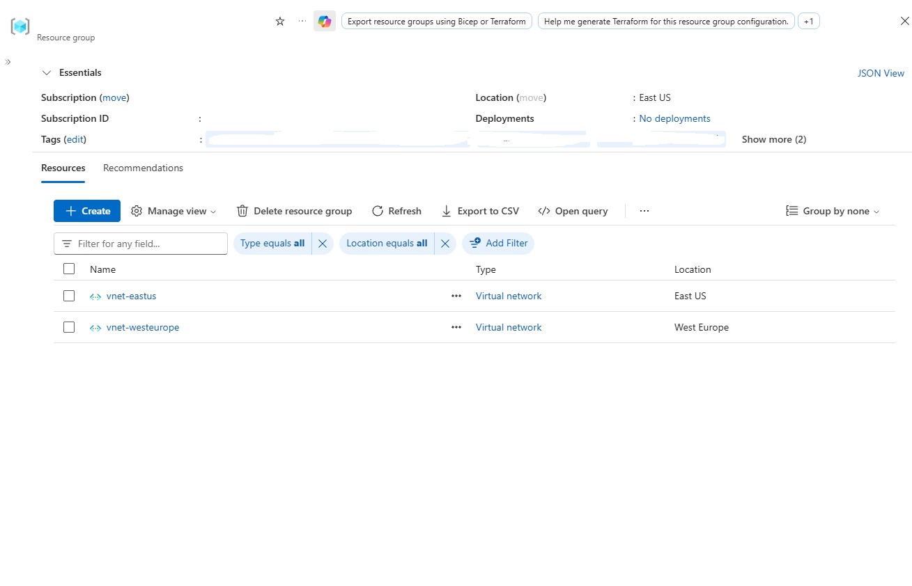
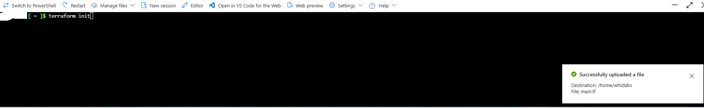
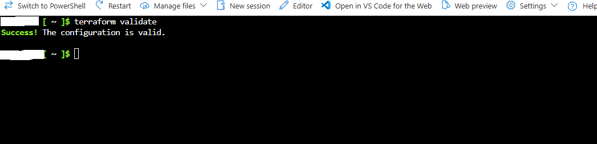
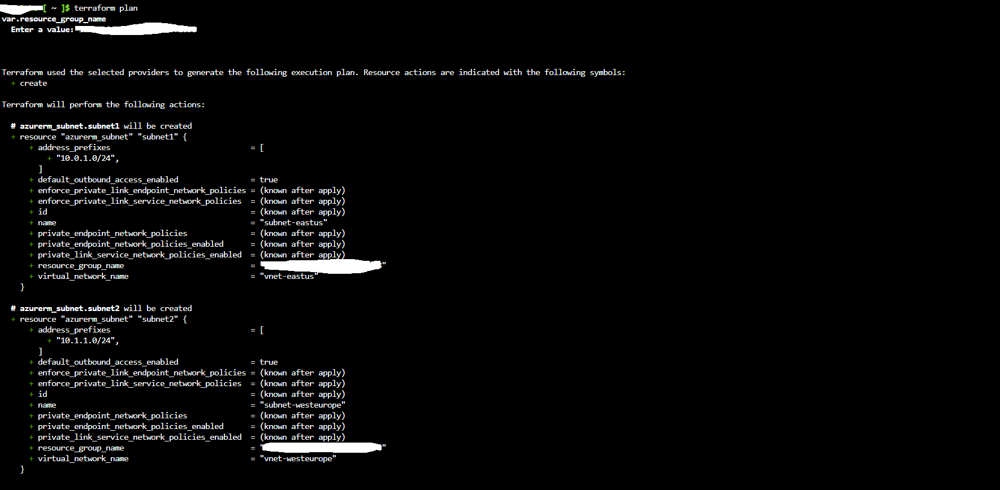
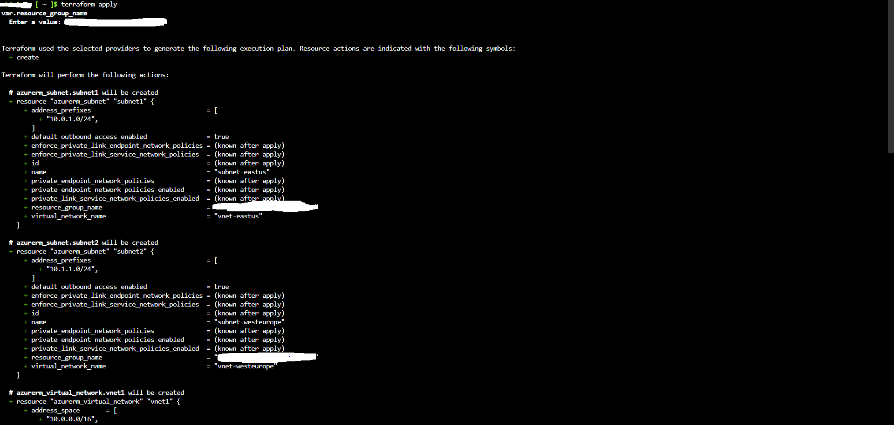
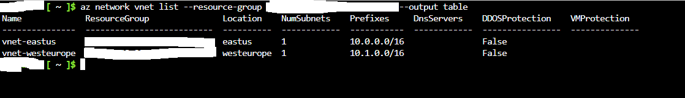
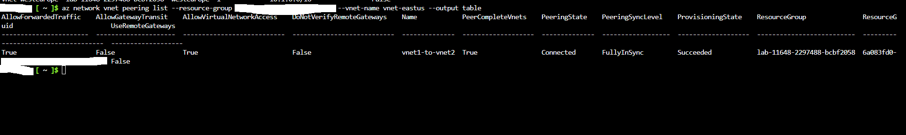

# Multi-Region Global Virtual Network Peering with Terraform

Comprehensive documentation detailing the declarative provisioning of cross-region Azure Virtual Networks and the establishment of bidirectional Global VNet Peering using HashiCorp Terraform and Azure CLI.

---

## 1. Architecture & Provisioned Resources

### Core Infrastructure Topology

| Resource | Resource Name | Region | Address Space / Prefix |
| :--- | :--- | :--- | :--- |
| **Virtual Network (Primary)** | `vnet-eastus` | East US | `10.0.0.0/16` |
| **Subnet (Primary)** | `subnet-eastus` | East US | `10.0.1.0/24` |
| **Virtual Network (Remote)** | `vnet-westeurope` | West Europe | `10.1.0.0/16` |
| **Subnet (Remote)** | `subnet-westeurope` | West Europe | `10.1.1.0/24` |
| **Global Peering Link 1** | `vnet1-to-vnet2` | East US ➔ West Europe | State: `Connected` / `FullyInSync` |
| **Global Peering Link 2** | `vnet2-to-vnet1` | West Europe ➔ East US | State: `Connected` / `FullyInSync` |

---

### Provisioned Environment Validation

*Resource group inventory confirming the deployment of cross-region virtual networks across East US and West Europe.*

---

## 2. Step-by-Step Implementation

### Step 1: Upload Terraform Configuration and Initialize Working Directory

Uploaded the declarative `main.tf` configuration file to the Azure Cloud Shell environment and initialized the Terraform working directory to prepare provider plugins and local state.

* **Configuration File:** `main.tf`
* **Command Executed:** `terraform init`
* **File Upload Confirmation:** Uploaded to `/home/whizlabs/main.tf`

*Uploading main.tf and executing terraform init within the Cloud Shell terminal.*

---

### Step 2: Validate Terraform Syntax and Configurations

Validated the structure, syntax, and attribute integrity of the Terraform configuration before initiating deployment plans.

* **Command Executed:** `terraform validate`
* **Validation Output:** `Success! The configuration is valid.`

*Confirming valid syntax and provider block schemas.*

---

### Step 3: Generate Execution Plan

Ran the planning phase to inspect the scheduled actions and ensure accurate cross-region network blocks, subnets, and peering resources.

* **Command Executed:** `terraform plan`
* **Resources Scheduled:**
  * `azurerm_subnet.subnet1` (`subnet-eastus` - `10.0.1.0/24`)
  * `azurerm_subnet.subnet2` (`subnet-westeurope` - `10.1.1.0/24`)
  * `azurerm_virtual_network.vnet1` (`vnet-eastus` - `10.0.0.0/16`)

*Generating execution plan detailing the resources slated for deployment.*

---

### Step 4: Apply Multi-Region Infrastructure Deployment

Executed the Terraform deployment pipeline to provision the cross-region virtual networks, subnets, and peering links.

* **Command Executed:** `terraform apply`
* **Target Actions:** Create virtual networks, address prefixes, and peering configurations

*Applying Terraform plan to provision multi-region network infrastructure.*

---

### Step 5: Verify Virtual Network Allocations via Azure CLI

Queried the Azure CLI to inspect both virtual networks and confirm proper regional placement and non-overlapping IP address prefix allocations.

* **Query Command:** `az network vnet list --output table`
* **East US Allocation:** `vnet-eastus` (`10.0.0.0/16`, 1 Subnet)
* **West Europe Allocation:** `vnet-westeurope` (`10.1.0.0/16`, 1 Subnet)

*Azure CLI table output verifying deployed virtual network spaces and regions.*

---

### Step 6: Verify Global Peering Connectivity and Sync State

Inspected the global peering configuration using Azure CLI to validate bidirectional link synchronization and network access between the East US and West Europe environments.

* **Query Command:** `az network vnet peering list --vnet-name vnet-eastus --output table`
* **Peering Name:** `vnet1-to-vnet2`
* **Peering State:** `Connected`
* **Peering Sync Level:** `FullyInSync`
* **Allow Virtual Network Access:** `True`
* **Allow Forwarded Traffic:** `True`

*Confirming active, connected, and synchronized global virtual network peering.*
